<p align="center">
  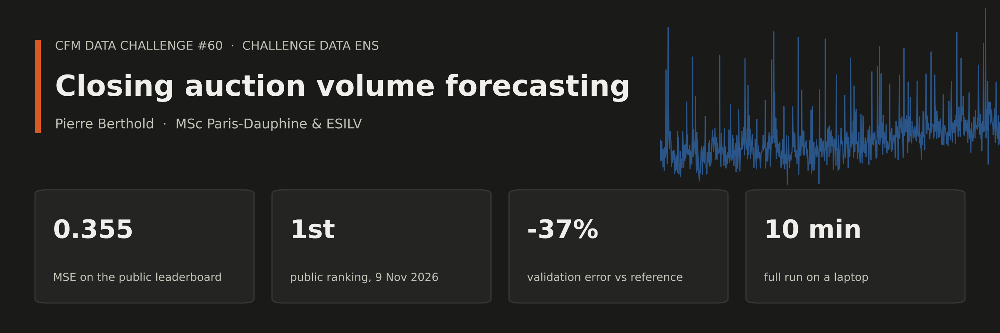
</p>

<p align="center">
  
  
  
  
  
</p>

<p align="center">
  <a href="#1-the-problem">Problem</a> ·
  <a href="#3-the-idea-two-parts">Model</a> ·
  <a href="#7-no-look-ahead">Look-ahead</a> ·
  <a href="#8-how-everything-was-validated">Validation</a> ·
  <a href="#10-limits">Limits</a> ·
  <a href="#11-run-it">Run it</a> ·
  <a href="#glossary">Glossary</a>
</p>

For 900 stocks and 347 future days, predict how much of the day's trading happens in the closing auction. The challenge is set by CFM and hosted by [Challenge Data ENS](https://challengedata.ens.fr/challenges/60).

The model is a sum of two simple parts, each validated on its own: **what the whole market does that day**, plus **where a stock sits relative to the others**. Most of the work is in the validation, not in the model.

| | Score (MSE, lower is better) |
|---|---|
| **Public leaderboard** | **0.3550**, ranked 1st when submitted (9 Nov 2026) |
| Validation, same model | 0.333 (0.309 to 0.360 depending on the split) |
| Reference built from the benchmark description, same validation | 0.525 |

> [!TIP]
> New to some of the vocabulary? The [glossary](#glossary) explains each term in two lines, including what a t-statistic is and why it is used here.

<details>
<summary><b>Table of contents</b></summary>

**Part I. The problem and the data**
1. [The problem](#1-the-problem)
2. [What the data look like](#2-what-the-data-look-like)

**Part II. The model**

3. [The idea: two parts](#3-the-idea-two-parts)
4. [Part 1: the day effect](#4-part-1-the-day-effect)
5. [Part 2: the stock effect](#5-part-2-the-stock-effect)
6. [Hyperparameters and regularization](#6-hyperparameters-and-regularization)

**Part III. The evidence**

7. [No look-ahead](#7-no-look-ahead)
8. [How everything was validated](#8-how-everything-was-validated)
9. [What did not work](#9-what-did-not-work)
10. [Limits](#10-limits)

**Part IV. Run it and vocabulary**

11. [Run it](#11-run-it)
12. [Glossary](#glossary)

</details>

<p align="center"></p>

## 1. The problem

**Target.** One number per stock and per day:

```
target = log( closing auction volume / volume traded during the day's 61 intraday periods )
```

A target of -2 means the auction is worth about 14% of the intraday volume. A target above 0 means the auction was larger than the whole intraday session.

> [!IMPORTANT]
> **Why it is hard.** All 347 test days come after the 805 training days. The model never sees a target from the test period, and the organizer warns that auction volumes grow over time. This is forecasting under drift, not filling gaps.

**Inputs.** Per stock and day: 61 absolute returns, 61 volume shares (one per intraday period), and two undisclosed variables, `LS` and `NLV`.

## 2. What the data look like

Four measured facts drive every design choice below.

**Fact 1. A missing period means "no trade".** A return and a volume share are always missing together, and the remaining volume shares still sum to 1. Missing values are therefore set to 0 (no volume, no price move) and never interpolated. The number of empty periods is kept as a feature: it measures how illiquid the stock was that day.

**Fact 2. The whole market moves together on some days.** On a few days per quarter, every stock trades far more at the close than usual. The slow level also rises over time.

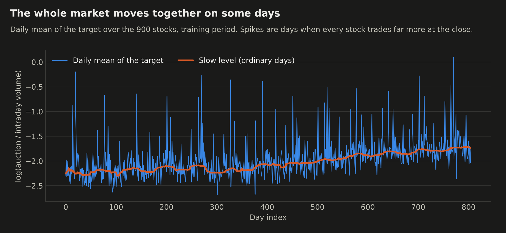

**Fact 3. The variance has three sources**, and they call for different tools.

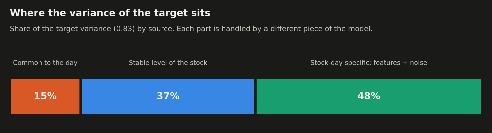

**Fact 4. `NLV` behaves like the day's intraday volume.** For a given stock, a day with a high `NLV` has a lower target, with a slope between -0.75 and -0.8. This makes sense: the intraday volume is the denominator of the target. "How unusual is today's volume for this stock" is the strongest same-day signal.

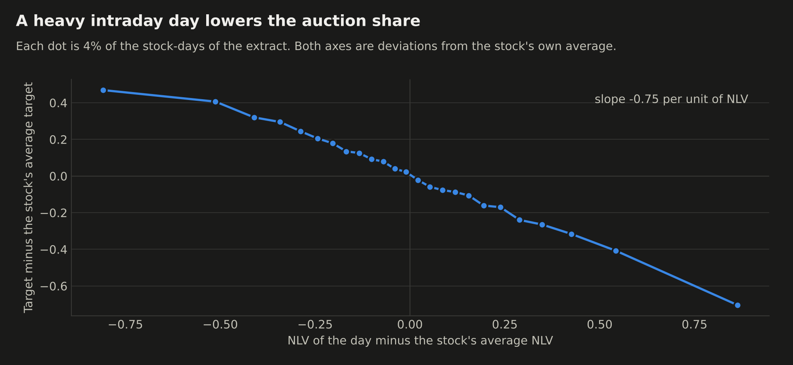

<p align="center"></p>

## 3. The idea: two parts

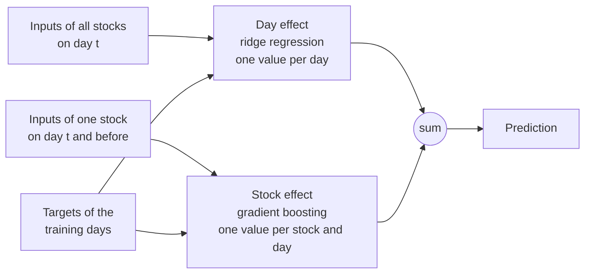

```
prediction(stock, day) = day effect(day) + stock effect(stock, day)
```

Why split? A single model fed with everything has to learn two very different things at once: a time series with 805 points (the day effect) and a cross-section with 684,482 rows (the stock effect). Boosted trees are good at the second and bad at the first, because a tree cannot extrapolate a trend: for any future day it reuses the level of the last training days. Splitting lets each part use the right tool and be validated separately.

> [!NOTE]
> The stock model is trained on `target - mean target of the day`, so it only ever learns differences between stocks.

## 4. Part 1: the day effect

**What it predicts.** The mean target of the day over all stocks.

**Model.** A ridge regression fitted on the training days, with 18 day-level features:

| Family | Count | What it captures |
|---|---|---|
| Event-day and day-type indicators | 14 | Recurring days on which the entire market trades more at the close. The largest are worth +0.7 to +1.7 on the daily mean. |
| Half-session flag and its interaction | 2 | Days where a third of the periods have no trades at all. |
| Market-wide activity | 2 | Average volume and average volatility of the day, compared with the previous 20 days. |

This README does not document how the event-day indicators are built.

**The slow level.** Before fitting, the slow level of the series is removed with a 41-day centered median over ordinary days, so that the regression only explains deviations from it. In the test period the level is unknown and has to be extrapolated:

- anchor: average level of the last 60 training days;
- slope: slope of the level over the whole training history.

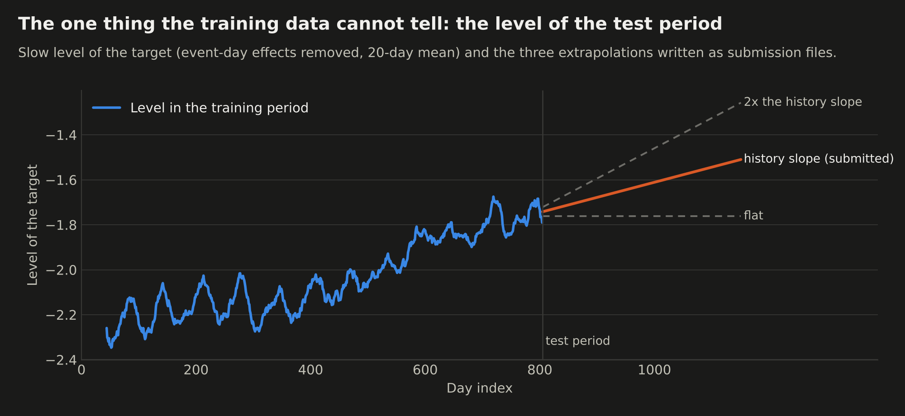

**How it was validated.** MSE of the predicted day effect against the true daily mean, on the three splits of section 8:

| Day model | Split A | Split B | Split C | Mean |
|---|---|---|---|---|
| Constant (training mean) | 0.197 | 0.205 | 0.195 | 0.199 |
| Same-day inputs only, no event-day indicators | 0.112 | 0.076 | 0.075 | 0.088 |
| **Full day model** | **0.059** | **0.041** | **0.025** | **0.042** |

## 5. Part 2: the stock effect

**What it predicts.** `target - day mean`: where the stock sits relative to the other stocks of the same day.

**Model.** LightGBM (boosted decision trees) on 157 features, none of which is the day index or the stock identifier. Both are left out on purpose: the day index cannot be extrapolated by trees, and a stock identifier lets the model memorize instead of learning from the stock's measurable behaviour.

### Features, family by family

Each family was added in turn and kept only if it lowered the validation error.

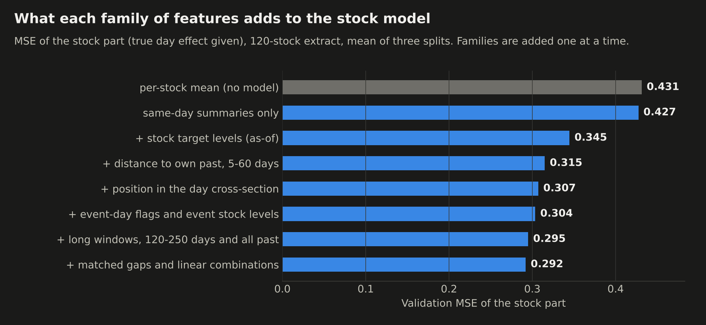

| Step | Family | Idea in one line |
|---|---|---|
| 1 | Same-day summaries (34) | Compress the 61 periods: volume at the open and near the close, concentration, timing, volatility, number of empty periods. |
| 2 | Stock target levels (6) | The stock's average target over its last 20, 60, 250 days and its whole history, as known on a past date (see below). |
| 3 | Distance to own past (56) | Today's `NLV`, `LS`, volatility and volume profile minus the stock's own average over the previous 5, 20 and 60 days. |
| 4 | Position in the day (14) | The same quantities minus the day's average over all stocks, and as a rank within the day. |
| 5 | Event-day information (12) | Day-type flags, and the stock's usual behaviour on event days. |
| 6 | Long windows (20) | Distances to the stock's average over 120 and 250 days, and over all its past. |
| 7 | Matched gaps (15) | Today's inputs minus the stock's inputs over the exact window used for its target level, and the combination `level - 0.8 x volume gap`. |

Step 7 hands the trees a ready-made version of fact 4. Trees approximate a sum of two features poorly; giving them the sum directly is cheap and ends up as the most used feature.

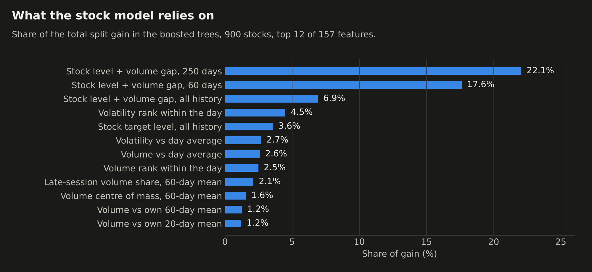

### Stale stock levels: training the way the model will be used

In the test, the last known target of a stock is at day 804, and the model has to predict up to 347 days later. The stock's "usual level" is therefore between 1 and 347 days old when it is used.

If the model were trained with levels computed up to the previous day, it would learn to trust them fully, and then be wrong in the test, where they are old.

> [!NOTE]
> Each training row gets its stock levels **as of a past day `t - h`, with `h` drawn at random between 1 and 347**, and `h` is given as a feature. The model learns how much to trust a level depending on its age.

| Stock levels in training | Split A | Split B | Split C |
|---|---|---|---|
| As of the previous day | 0.3110 | 0.3037 | 0.2893 |
| **As of a random past day (kept)** | **0.3094** | **0.2962** | **0.2844** |

(MSE of the stock part, 120-stock extract, squared loss.)

### Two losses, then a re-centring

- Two models are trained on the same features, one minimizing the squared error and one the absolute error, and their predictions are averaged. The absolute error is less sensitive to the extreme days. On 900 stocks the average scores 0.2912 against 0.2914 and 0.2942 for the two models alone, and it has the best MAE as well.
- Predictions are shifted so that their mean is zero on each day. The training target has a zero mean per day by construction, so any non-zero daily mean in the predictions is pure error. Gain: 0.2943 to 0.2912.

## 6. Hyperparameters and regularization

No hyperparameter search was run. The values below are standard, fixed in advance, and only checked against a few alternatives (section 9). With 805 days of history, a long search would mostly fit the validation periods.

| Where | Setting | Value | Role |
|---|---|---|---|
| Stock model | Learning rate | 0.05 | Small steps, each tree corrects a little. |
| | Number of trees | 900 | Chosen among 300, 600, 900 on validation (0.2925, 0.2912, 0.2911). |
| | Leaves per tree | 63 | Complexity of one tree. |
| | Minimum rows per leaf | 100 | A rule must hold for at least 100 stock-days. |
| | Rows used per tree | 80% | Each tree sees a random subset of rows. |
| | Features used per tree | 50% | Each tree sees a random half of the features. |
| | L2 penalty on leaf values | 5 | Pulls leaf predictions towards zero. |
| | Losses averaged | squared, absolute | Robustness to extreme days. |
| | Random seeds averaged | 3 | Averages out the randomness of the draws. |
| Stock levels | Shrinkage | sum / (n + 5) | A level based on few days is pulled towards zero. |
| Day model | Ridge penalty | 1.0, on standardized features | Keeps the 18 coefficients stable with about 780 days. |
| | Detrending window | 41 days | Centered median over ordinary days. |
| | Level anchor | last 60 training days | Starting point of the extrapolation. |

**Regularization in plain words.** Every setting above limits how closely the model can follow the training data. The structural choices do the same job: no day index, no stock identifier, two losses, three seeds, and a zero mean per day.

<p align="center"></p>

## 7. No look-ahead

The test file contains all 347 test days at once, so it would be technically possible to use the inputs of day `t+1` to predict day `t`. This project forbids it.

**Rules.**

1. A feature of day `t` uses inputs of day `t` or earlier only.
2. Same-day statistics across stocks are allowed, for inputs only.
3. Anything computed from the target only reads targets up to an explicit "as-of" day, which is never later than the last training day.
4. Everything fitted (ridge, trees, slopes, number of trees) is fitted on training days.

**Automated checks** ([`tests/test_no_lookahead.py`](tests/test_no_lookahead.py)). The features are built twice: on the full data, and on a copy where the future is deleted or replaced by noise. The past must come out identical.

| Check | Result |
|---|---|
| 124 input features, days after day 600 deleted | identical on days up to 600 |
| 24 target-based features, targets after the as-of day replaced by noise | identical |
| Day model fitted up to day 600, later targets replaced by a constant | identical predictions |

**What the rule costs.** Relaxing rule 1 (windows centred on the day, averages over the whole sample) was tested on the 120-stock extract and gave no gain: MSE 0.3108 / 0.2948 / 0.2841 on the three splits, against 0.3094 / 0.2962 / 0.2844 for the strict version. The strict version is the one submitted.

## 8. How everything was validated

**Splits copy the real task.** Train on days 0 to T, predict the following days, for three values of T. Splitting rows at random would let the model see the future of each stock and give scores that mean nothing for the test.

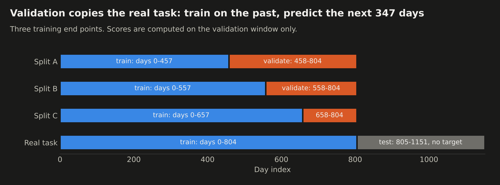

**References built from scratch**, scored on the same splits: the per-stock mean, a linear model on the raw inputs, and the structure of the official benchmark (linear model, then boosted trees on its residuals).

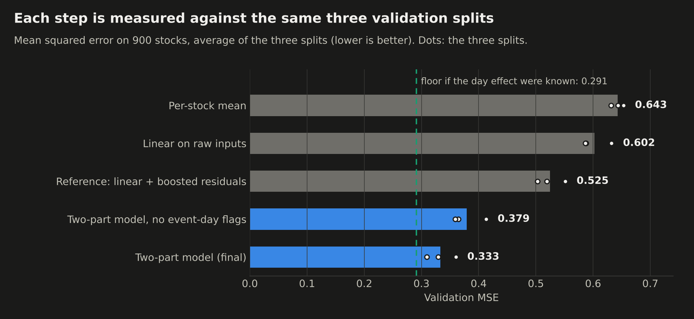

| Model, 900 stocks | Split A | Split B | Split C | Mean MSE | Mean MAE |
|---|---|---|---|---|---|
| Per-stock mean | 0.653 | 0.644 | 0.631 | 0.643 | 0.597 |
| Linear on raw inputs | 0.632 | 0.588 | 0.587 | 0.602 | 0.592 |
| Reference: linear + boosted residuals | 0.551 | 0.520 | 0.503 | 0.525 | 0.556 |
| Two-part model, no event-day flags | 0.413 | 0.364 | 0.359 | 0.379 | 0.452 |
| **Two-part model (final)** | **0.360** | **0.330** | **0.309** | **0.333** | **0.425** |
| Stock part alone, true day effect given | 0.301 | 0.289 | 0.284 | 0.291 | 0.399 |

The last row is not a model that can be submitted. It shows the floor of this design: 0.291 if the day effect were known exactly. The gap to 0.333 is what the day model still gets wrong.

**Is the gain real or luck?** Rows of the same day are not independent: they share the day's market move. The unit of evidence is therefore the day, not the row. For each validation day, the loss of the final model minus the loss of the reference is computed, and the mean of these daily differences is tested (see [t-statistic](#glossary)).

| Split | Days | Mean MSE difference | t-statistic | Days where the final model wins |
|---|---|---|---|---|
| A | 347 | -0.192 | -14.5 | 92% |
| B | 247 | -0.191 | -11.6 | 99.6% |
| C | 147 | -0.195 | -10.0 | 99.3% |

**The error by horizon.** The further from the last training day, the larger the error, as expected: stock levels get stale and the market level drifts.

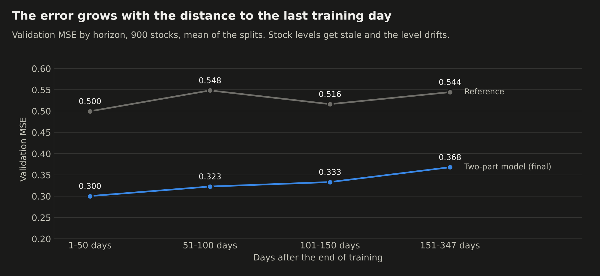

> [!NOTE]
> **Out of sample.** The public leaderboard score, 0.3550, falls inside the validation range (0.309 to 0.360). The validation was honest about what to expect.

## 9. What did not work

Tested on the same splits and dropped. Scores are the MSE of the stock part on the 120-stock extract (squared loss, mean of the three splits).

| Idea | Result |
|---|---|
| Giving the trees the 122 raw columns next to the summaries | No gain. |
| Windows centred on the day, whole-sample stock averages (look-ahead) | No gain: mean 0.2966 against 0.2967. |
| Stock identifier as a categorical feature | No gain. |
| Larger trees (127 leaves, 50 rows per leaf) | Worse: 0.2993 against 0.2967. |
| Smaller trees (31 leaves, 900 of them) | Slightly worse: 0.2976 against 0.2967. |
| More windows for the stock levels (120 and 500 days) | No gain: 0.2967 against 0.2967. |
| Stock levels as of the previous day | Worse on all three splits (section 5). |
| More day-level activity features | Gain below 0.002, not kept. |

## 10. Limits

> [!WARNING]
> The first limit is the one that matters most for the final ranking.

- **The level of the test period cannot be learned from the training data.** With the slope of the whole history, the predicted level was too low by 0.16 and 0.12 on splits A and B, and right on split C. Two other submission files are written with a flat level and with twice the slope. Only the main one was submitted.
- **Three splits are not three independent experiments.** They overlap, and the history contains a single episode of rising auction shares.
- **Feature families were screened on a 120-stock extract**, then the complete pipeline was confirmed on the 900 stocks.
- **`LS` is used without knowing what it is.**
- **The public leaderboard covers part of the test set.** The private ranking may differ.

<p align="center"></p>

## 11. Run it

```bash
pip install -r requirements.txt
# put input_training.csv.gz, output_training_IxKGwDV.csv and input_test.csv.gz in data/
python experiments/04_pipeline.py        # validation, final fit, submission files
python tests/test_no_lookahead.py        # look-ahead checks
python experiments/05_figures.py         # figures of this README (needs data/sample/)
```

| Path | Content |
|---|---|
| [`src/features.py`](src/features.py) | Stock-day features and target levels as of a given day |
| [`src/daymodel.py`](src/daymodel.py) | Day effect: ridge regression and level extrapolation |
| [`src/stockmodel.py`](src/stockmodel.py) | Stock effect: LightGBM, two losses, several seeds |
| [`src/metrics.py`](src/metrics.py) | Scores and paired tests by day |
| [`experiments/04_pipeline.py`](experiments/04_pipeline.py) | The whole pipeline, from the CSV files to the submission |
| [`experiments/01` to `03`](experiments/) | Earlier work: data audit, residual analysis, validation over several training ends |
| [`tests/`](tests/) | Synthetic data generator and look-ahead checks |

## Glossary

**Closing auction.** The last trade of the day. All orders are matched at a single price, which becomes the official closing price.

**Target.** The quantity to predict: `log(auction volume / intraday volume)`.

**MSE, MAE.** Mean squared error and mean absolute error between predictions and true values. Lower is better. MSE punishes large errors more.

**Training end, horizon.** The training end is the last day whose target the model may see. The horizon is the number of days between that day and the day being predicted.

**Look-ahead (leakage).** Using information that would not be available at prediction time. It makes validation scores look better than what the model will really do.

**Cross-section.** All the stocks on one given day.

**Day effect, stock effect.** The part of the target shared by all stocks on a day, and the part specific to one stock on that day.

**Ridge regression.** A linear regression with a penalty on large coefficients, which keeps them stable when there are few observations.

**Gradient boosting, LightGBM.** Many small decision trees fitted one after the other, each correcting the errors of the previous ones. LightGBM is a fast implementation.

**Regularization.** Anything that stops a model from following the training data too closely: penalties, minimum leaf sizes, subsampling, averaging.

**Shrinkage.** Pulling an estimate towards a neutral value when it is based on few observations.

**Loss.** What a model minimizes during training: the squared error (L2) or the absolute error (L1).

**Seed.** The starting point of the random numbers. Averaging models trained with different seeds removes part of the randomness.

**As-of level.** A stock's average target computed only with the days up to a given date.

**Ablation.** Removing or adding one component at a time to measure what it contributes.

**Extrapolation.** Predicting outside the range seen in training, here beyond the last training day.

**Paired test.** Comparing two models on the same days by testing the mean of their daily loss differences. Pairing removes what both models share, such as a hard day.

**t-statistic.** `t = mean difference / standard error of that mean`. It says how many standard errors the observed gap is away from zero. An absolute value above about 2 means the gap is unlikely to be luck.

*Why a t-statistic and not a z-score.* The two share the same formula. A z-score assumes the true standard deviation of the daily differences is known. Here it is not: it is estimated from the same 147 to 347 days, and that estimate is itself uncertain. A ratio built on an estimated standard deviation is a t-statistic, and it is read against Student's t distribution, which has slightly heavier tails than the normal to account for that extra uncertainty. With this many days the two distributions are almost identical, so the choice changes the name more than the conclusion.

**Newey-West standard error.** The usual standard error assumes the daily differences are independent. They are not: a good day is often followed by another. The Newey-West formula widens the standard error to account for the correlation between nearby days (10 lags here), which makes the t-statistics smaller and more honest.
